  
  
  

## About

Final-year Computer Science student at USAL, Lebanon, and a 42 Beirut student, with a focus on full-stack web development. Hands-on practice with SOLID principles and design patterns, and stack-agnostic, picking whatever tools fit the problem best.

## Languages

## Frameworks & libraries

## Tools & testing

## Practices

## Projects

### [Sakkerha](https://github.com/alialridaalnajjar/REPO)

### [Devart](https://github.com/alialridaalnajjar/REPO)

### [AR Warehouse](https://github.com/alialridaalnajjar/REPO) · *legacy*

## LeetCode

